# 🛰️ CrisisLens — disaster-response triage LLM, trained with AutoScientist

CrisisLens reads one social-media post written during a disaster and returns a strict JSON triage record
(`category`, `actionable`, `urgency 1–5`, `location`, `needs`, `rationale`). It is a **Qwen3.5-2B + LoRA** model
trained with **Adaption Labs AutoScientist** on HumAID, evaluated on **four disasters it never saw in training**,
and served for **$0 on a CPU** with llama.cpp.

<!-- RESULTS:START -->
_Results are filled in by `eval/make_report.py` — see `eval/results/summary.md`._
<!-- RESULTS:END -->

## Architecture

```mermaid
flowchart LR
  A[HumAID 76,484 tweets<br/>HF QCRI/HumAID-all] --> B[Event recovery<br/>paper counts + DP check 99.99%]
  B --> C[Clean + exact/near dedupe<br/>cos≥0.9, cross-split guard]
  C --> D{Event-level split}
  D -->|15 events| E[Train 49,417 / Val 5,491]
  D -->|Kerala · Idai · Mexico · Dorian| F[Test 21,527<br/>LLM eval subset 1,219]
  E --> G[Class-capped SFT subset 17,784]
  G --> H[Teacher LLM gemma-4-31b-it<br/>silver actionable/urgency/location/needs]
  H --> I[SFT CSV prompt/completion]
  I --> J[AutoScientist runs #1–#5<br/>recipe search · win-rate judge]
  J --> K[Best LoRA checkpoint<br/>PEFT → GGUF]
  K --> L[llama.cpp CPU server<br/>Q4_K_M base + f16 LoRA]
  L --> M[Eval harness<br/>gold macro-F1 · silver fields · JSON · latency]
  L --> N[Gradio demo<br/>analyzer · live triage queue · metrics]
  F --> M
```



## Repository

| Path | What |
|---|---|
| `src/data/` | `prepare.py` (event recovery, cleaning, dedupe, event split), `select_train.py`, `make_eval_subset.py`, `teacher_label.py`, `build_sft.py` |
| `src/prompt.py`, `src/sft_format.py` | schema, class definitions, prompts (v1/v2), strict JSON validator |
| `src/train/autoscientist_run.py` | upload (raw mode) → launch → poll/log every state → download (zstd tar) |
| `src/serve/lora_to_gguf.sh` | PEFT LoRA → GGUF adapter (llama.cpp converter) |
| `eval/` | baselines, LLM runner, scorer, report/plots, teacher-verification sheet, all results JSON/CSV |
| `eval/autoscientist/` | **every polled AutoScientist run state + launch request + trainer_state.json** (training-run evidence) |
| `demo/` | Gradio app, Docker Space (llama.cpp + Gradio), cached outputs |
| `docs/` | `DATA_CARD.md`, `MODEL_CARD.md`, `autoscientist_objective.md` |
| `PROGRESS.md` | timestamped log of the 8-hour build, including blockers and mistakes |

No raw data is committed (HumAID is CC BY-NC-SA 4.0); scripts rebuild everything from the HF mirror. Silver labels
are committed keyed by hashed ids (no tweet text).

## Reproduce

```bash
pip install pandas pyarrow scikit-learn adaption openai matplotlib gradio zstandard
# 1. data  (downloads QCRI/HumAID-all parquet into data/raw/ first — see src/data/assign_events.py docstring)
python -I src/data/assign_events.py data/raw data/interim      # independent DP event segmentation (cross-check)
python -I src/data/prepare.py                                  # clean, dedupe, event-level split
python -I src/data/make_eval_subset.py 300 && python -I src/data/select_train.py 2000
# 2. baselines
python -I eval/baseline_tfidf.py
# 3. silver labels (ADAPTION_API_KEY in .env)
python -I src/data/teacher_label.py data/processed/sft_select.parquet data/processed/teacher/sft_select.jsonl --model gemma-4-31b-it --workers 6 --batch 20
python -I src/data/build_sft.py sft_select sft_train_v2 v2
# 4. AutoScientist
python -I src/train/autoscientist_run.py launch --csv data/processed/sft_train_v2.csv --name crisislens-v2 --model Qwen/Qwen3.5-2B \
       --max-iterations 3 --target 0.9 --hp '{"learning_rate":0.0002,"n_epochs":3,"lora_r":32,"lora_alpha":64}'
python -I src/train/autoscientist_run.py poll --run <id>; python -I src/train/autoscientist_run.py download --run <id>
bash src/serve/lora_to_gguf.sh models/<id> Qwen/Qwen3.5-2B
# 5. serve + evaluate (llama.cpp b12052 CPU build)
llama-server -m Qwen3.5-2B-Q4_K_M.gguf --lora models/<id>/adapter-f16.gguf --port 8082 -c 2048 -np 1 --jinja --reasoning-budget 0
python -I eval/run_llm.py --mode finetuned --prompt-version v2 --model ft --base-url http://127.0.0.1:8082/v1 --name ft2b_run5
python -I eval/score.py ft2b_run5 && python -I eval/make_report.py tfidf=TF-IDF+LR ft2b_run5="CrisisLens (AutoScientist)"
```
