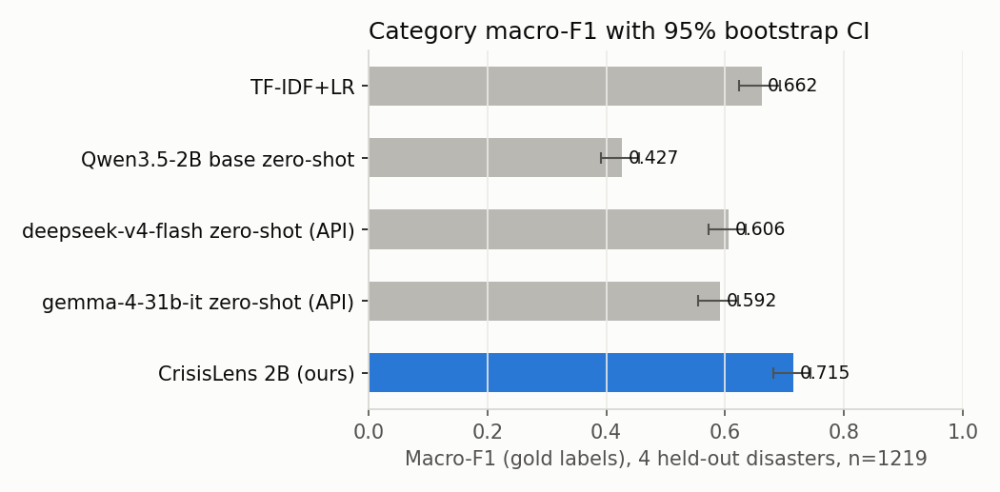
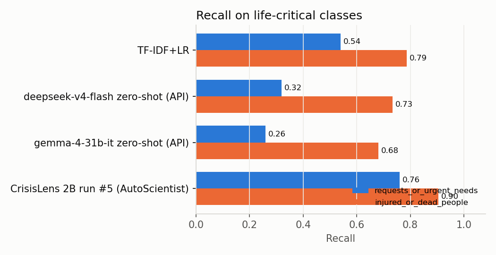
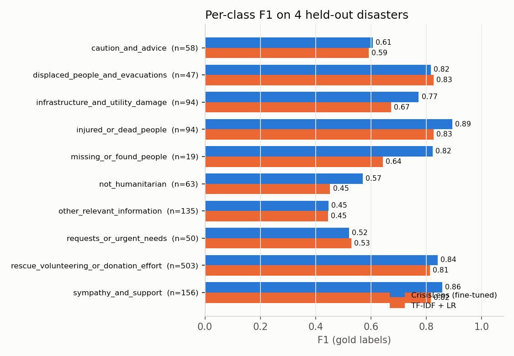
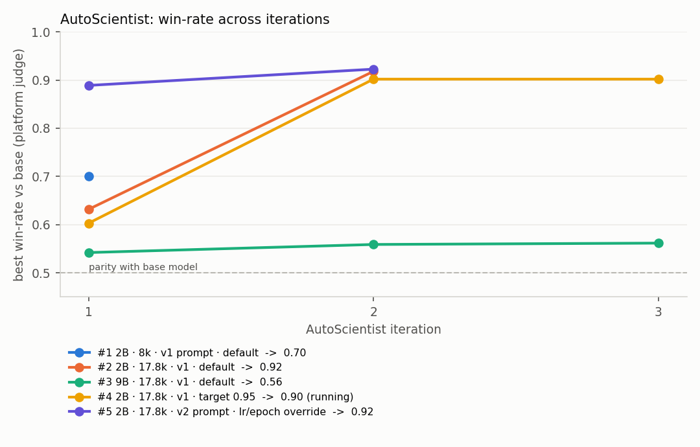

# 🛰️ CrisisLens — disaster-response triage LLM, trained with AutoScientist

CrisisLens reads one social-media post written during a disaster and returns a strict JSON triage record
(`category`, `actionable`, `urgency 1–5`, `location`, `needs`, `rationale`). It is a **Qwen3.5-2B + LoRA** model
trained with **Adaption Labs AutoScientist** on HumAID, evaluated on **four disasters it never saw in training**,
and served for **$0 on a CPU** with llama.cpp.

| | |
|---|---|
| **Live demo** | https://huggingface.co/spaces/Vishal-2109/crisislens |
| **Model (LoRA, GGUF + PEFT)** | https://huggingface.co/Vishal-2109/crisislens-qwen3.5-2b-lora |
| **Code** | https://github.com/2ViShAlv1/crisislens |
| **Write-ups** | [SUBMISSION.md](SUBMISSION.md) · [Model card](docs/MODEL_CARD.md) · [Data card](docs/DATA_CARD.md) · [Error analysis](docs/ERROR_ANALYSIS.md) · [Build log](PROGRESS.md) |

<!-- RESULTS:START -->
### Headline

**CrisisLens (2B, AutoScientist run #5) reaches macro-F1 0.715 [95% CI 0.682–0.743] on 1,219 posts from four disasters it never saw in training**, against 0.606 for the best frontier API zero-shot (deepseek-v4-flash) and 0.662 for TF-IDF + LR. Recall on `requests_or_urgent_needs` is 0.760 (best API: 0.320). It runs on a laptop CPU for $0 per 1,000 posts (APIs: $0.065–$0.070), and 99.9% of outputs pass the strict JSON schema.

### Test results: four held-out disasters (gold human labels)

| system                            | macro_f1             |   weighted_f1 |   recall_urgent_needs |   recall_injured_dead | json_valid   | latency/post   | usd_per_1k   |    n |
|:----------------------------------|:---------------------|--------------:|----------------------:|----------------------:|:-------------|:---------------|:-------------|-----:|
| TF-IDF+LR                         | 0.662 [0.623, 0.693] |         0.72  |                 0.54  |                 0.787 | —            | 0.35 ms        | —            | 1219 |
| Qwen3.5-2B base zero-shot         | 0.427 [0.391, 0.456] |         0.328 |                 0.619 |                 0.895 | 0.998        | 11.28 s        | $0.000       | 1033 |
| deepseek-v4-flash zero-shot (API) | 0.606 [0.573, 0.635] |         0.667 |                 0.32  |                 0.734 | 0.998        | 2.15 s         | $0.065       | 1219 |
| gemma-4-31b-it zero-shot (API)    | 0.592 [0.555, 0.622] |         0.67  |                 0.26  |                 0.681 | 1.000        | 1.00 s         | $0.070       | 1219 |
| CrisisLens 2B (ours)              | 0.715 [0.682, 0.743] |         0.759 |                 0.76  |                 0.904 | 0.999        | 5.01 s         | $0.000       | 1219 |

Macro-F1 is computed over the classes present (all 10 are present in this set) with a 1,000-sample bootstrap CI. The base-model zero-shot run was stopped by a memory guard at 1,035/1,219 posts and is scored on the 1,033 it answered. API latency is wall-clock through the Adaption gateway. Local latency is a 12-thread laptop CPU (i7-1255U), one request at a time.

### Model selection: validation set only

Candidates are compared on `val_eval` (574 posts, 60 per class, drawn from the 15 *training* disasters). The selected model is the only fine-tuned candidate run on the test set, so the test set played no part in any decision.

| run   | base       | training rows         | prompt   |   AutoScientist best win-rate |   val macro-F1 |   val weighted-F1 | val JSON valid   | selected   |
|:------|:-----------|:----------------------|:---------|------------------------------:|---------------:|------------------:|:-----------------|:-----------|
| #7    | Qwen3.5-2B | 37,267 (cap 5k/class) | v2       |                         0.913 |          0.793 |             0.789 | 100.0%           |            |
| #5    | Qwen3.5-2B | 17,784 (cap 2k/class) | v2       |                         0.923 |          0.791 |             0.787 | 100.0%           | ✅         |

Run #7 is 0.002 macro-F1 above the selected run #5 on validation. That is far inside both 95% CIs (about ±0.03 on 574 posts), so the two are statistically tied. Run #5 is shipped because it is the candidate that was fully evaluated on the test set in the time available. The test set was not used to choose between them.

Win-rate is AutoScientist's judge score against each run's own base model. It is useful for steering a run, but it does not rank models by triage accuracy, which is why selection uses the validation metric.

### Per-disaster macro-F1

| disaster               |   CrisisLens |   deepseek-v4-flash zero-shot (API) |
|:-----------------------|-------------:|------------------------------------:|
| Cyclone Idai 2019      |        0.617 |                               0.563 |
| Hurricane Dorian 2019  |        0.616 |                               0.439 |
| Kerala floods 2018     |        0.72  |                               0.585 |
| Mexico earthquake 2017 |        0.675 |                               0.56  |

### Structured fields (scored against teacher silver labels, not human labels)

| actionable acc   |   actionable F1 |   urgency MAE | urgency within ±1   |   urgent (≥4) F1 | location exact   | location overlap   |   needs Jaccard |
|:-----------------|----------------:|--------------:|:--------------------|-----------------:|:-----------------|:-------------------|----------------:|
| 92.4%            |           0.753 |          0.36 | 97.0%               |            0.703 | 85.9%            | 91.1%              |           0.761 |

Silver-label check: on 100 rows reviewed against the post text (a review by Claude, **not** a human annotator), the teacher was right on actionable 97.0%, urgency 100.0%, location 94.0%, needs 96.0%, and all fields 89.0%. See `eval/human_check/`.

### Comparison with the HumAID paper

Alam et al. (ICWSM 2021) report weighted-F1 0.758–0.760 (BERT/RoBERTa) on a **random** split, where training and test share events. CrisisLens scores weighted-F1 0.759 on an **event-level** split, which is harder because vocabulary, places and needs change between disasters. The numbers are not directly comparable, and the setting here is the harder one.

### AutoScientist runs

| run                                           |   iterations |   best_win_rate |   final_lr |   final_epochs |   final_lora_r |
|:----------------------------------------------|-------------:|----------------:|-----------:|---------------:|---------------:|
| #1 2B · 8k · v1 prompt · default              |            1 |          0.7    |    1e-05   |              1 |             16 |
| #2 2B · 17.8k · v1 · default                  |            2 |          0.9181 |    5e-05   |              3 |             32 |
| #3 9B · 17.8k · v1 · default                  |            3 |          0.5615 |    0.0002  |              4 |             64 |
| #4 2B · 17.8k · v1 · target 0.95              |            5 |          0.9322 |    0.00015 |              6 |             48 |
| #5 2B · 17.8k · v2 prompt · lr/epoch override |            2 |          0.9227 |    0.00015 |              4 |             32 |
| #6 4B · 17.8k · v2 · run #5 recipe            |            3 |          0.7536 |    0.00015 |              4 |             32 |
| #7 2B · 37k (cap 5k) · v2 · run #5 recipe     |            3 |          0.9128 |    0.00015 |              3 |             32 |
| #8 2B · 49k (all) · v2 · 2 epochs             |            2 |          0.9199 |    0.00015 |              2 |             32 |

Every polled state, launch request and `trainer_state.json` is in `eval/autoscientist/`. Charts: `demo/assets/3_autoscientist_iterations.png`, `4_autoscientist_loss.png`.






<!-- RESULTS:END -->

## Architecture

```mermaid
flowchart LR
  A[HumAID 76,484 tweets<br/>HF QCRI/HumAID-all] --> B[Event recovery<br/>paper counts + DP check 99.99%]
  B --> C[Clean + exact/near dedupe<br/>cos≥0.9, cross-split guard]
  C --> D{Event-level split}
  D -->|15 events| E[Train 49,417 / Val 5,491]
  D -->|Kerala · Idai · Mexico · Dorian| F[Test 21,527<br/>LLM eval subset 1,219]
  E --> G[Class-capped SFT subset 17,784]
  G --> H[Teacher LLM gemma-4-31b-it<br/>silver actionable/urgency/location/needs]
  H --> I[SFT CSV prompt/completion]
  I --> J[AutoScientist runs #1–#8<br/>recipe search · win-rate judge]
  J --> K[Checkpoint chosen on validation<br/>PEFT → GGUF]
  K --> L[llama.cpp CPU server<br/>Q4_K_M base + f16 LoRA]
  L --> M[Eval harness<br/>gold macro-F1 · silver fields · JSON · latency]
  L --> N[Web console: FastAPI + custom UI<br/>triage queue · analyzer · evaluation]
  F --> M
```



## Repository

| Path | What |
|---|---|
| `src/data/` | `prepare.py` (event recovery, cleaning, dedupe, event split), `select_train.py`, `make_eval_subset.py`, `teacher_label.py`, `build_sft.py` |
| `src/prompt.py`, `src/sft_format.py` | schema, class definitions, prompts (v1/v2), strict JSON validator |
| `src/train/autoscientist_run.py` | upload (raw mode) → launch → poll/log every state → download (zstd tar) |
| `src/serve/lora_to_gguf.sh` | PEFT LoRA → GGUF adapter (llama.cpp converter) |
| `eval/` | baselines, LLM runner, scorer, report/plots, teacher-verification sheet, all results JSON/CSV |
| `eval/autoscientist/` | **every polled AutoScientist run state + launch request + trainer_state.json** (training-run evidence) |
| `demo/` | web console (`server.py` FastAPI + `web/`), Docker Space (llama.cpp + console), cached outputs (`build_cache.py`) |
| `docs/` | `DATA_CARD.md`, `MODEL_CARD.md`, `ERROR_ANALYSIS.md`, `autoscientist_objective.md` |
| `scripts/` | `eval_cand.sh` (one candidate, one split), `alarm.ps1`, `publish.ps1` / `publish_hf.py` |
| `PROGRESS.md` | timestamped log of the 8-hour build, including blockers and mistakes |

No raw data is committed (HumAID is CC BY-NC-SA 4.0); scripts rebuild everything from the HF mirror. Silver labels
are committed keyed by hashed ids (no tweet text).

## Reproduce

```bash
pip install pandas pyarrow scikit-learn adaption openai matplotlib zstandard fastapi uvicorn httpx tabulate
# 1. data  (downloads QCRI/HumAID-all parquet into data/raw/ first — see src/data/assign_events.py docstring)
python -I src/data/assign_events.py data/raw data/interim      # independent DP event segmentation (cross-check)
python -I src/data/prepare.py                                  # clean, dedupe, event-level split
python -I src/data/make_eval_subset.py 300 && python -I src/data/select_train.py 2000
# 2. baselines
python -I eval/baseline_tfidf.py
# 3. silver labels (ADAPTION_API_KEY in .env)
python -I src/data/teacher_label.py data/processed/sft_select.parquet data/processed/teacher/sft_select.jsonl --model gemma-4-31b-it --workers 6 --batch 20
python -I src/data/build_sft.py sft_select sft_train_v2 v2
# 4. AutoScientist
python -I src/train/autoscientist_run.py launch --csv data/processed/sft_train_v2.csv --name crisislens-v2 --model Qwen/Qwen3.5-2B \
       --max-iterations 3 --target 0.9 --hp '{"learning_rate":0.0002,"n_epochs":3,"lora_r":32,"lora_alpha":64}'
python -I src/train/autoscientist_run.py poll --run <id>; python -I src/train/autoscientist_run.py download --run <id>
bash src/serve/lora_to_gguf.sh models/<id> Qwen/Qwen3.5-2B
# 5. serve + evaluate (llama.cpp b12052 CPU build)
llama-server -m Qwen3.5-2B-Q4_K_M.gguf --lora models/<id>/adapter-f16.gguf --port 8082 -c 2048 -np 1 --jinja --reasoning-budget 0
python -I eval/run_llm.py --mode finetuned --prompt-version v2 --model ft --base-url http://127.0.0.1:8082/v1 --name ft2b_run5
python -I eval/score.py ft2b_run5 && python -I eval/make_report.py tfidf=TF-IDF+LR ft2b_run5="CrisisLens 2B (ours)"
python -I eval/write_results_md.py ft2b_run5                   # fills the results section of this README
# 6. demo (local)
python -I demo/build_cache.py ft2b_run5 "CrisisLens 2B (ours)" --run <id>
cd demo && CRISISLENS_BASE_URL=http://127.0.0.1:8082/v1 uvicorn server:app --port 7860   # open http://127.0.0.1:7860
```

## Demo

A web console for a response desk, served from a Docker Space (llama.cpp + FastAPI, free CPU):

- **Triage console.** Replays held-out posts from the four test disasters through the model into a queue ranked by urgency, with KPIs, category mix, top needs, and a detail panel that shows the human (HumAID) label next to the model's answer.
- **Analyze a post.** Paste any post and get the live JSON record, with latency and whether it came from the live model or the cached outputs.
- **Evaluation.** Interactive charts of every number in this README.
- **Model.** The pipeline, the recipe, and the limits.

The UI starts immediately and loads the model in the background. If the model is unavailable, known posts fall back to cached evaluation outputs and the page says so.

## AutoScientist Community Leaderboard

Runs appear on the [AutoScientist leaderboard](https://adaptionlabs.ai/auto-scientist-leaderboard) automatically. Our listed entry (as of 2026-11-03) is run #2 (`adaption_qwen3_5_2b_crisislens_full_2b_2c060ec8`), domain **News**:

| Task Win % | Domain Win % | Normalised Score | Percentile |
|---|---|---|---|
| 91.8% | 55% | +0.13 | 36th |

The task win-rate is high, but the domain win-rate is only 55%: specialising on triage barely beats the base model on general News-domain evaluations. AutoScientist's documented fix is `augmentation_general_rows`, which adds general rows "to help the model keep broader capabilities". **Run #9** uses run #5's data and recipe plus augmentation (`augmentation_domain_rows=2216` to reach the recommended 20k, `augmentation_general_rows=8000`). It was launched after the submission write-up, and its results are in `eval/autoscientist/e70d8d4e-*.jsonl`.

## Honest notes: what went wrong and what is not claimed

- **The pilot model failed.** AutoScientist's default recipe (lr 1e-5, 1 epoch, 21 steps) produced invented labels ("relief", urgency "high"): 0% accuracy on a 69-post probe. The fix was to list the label set in the prompt (v2) and override lr and epochs (run #5).
- **Not every candidate was evaluated.** Runs #6 (4B), #7 (37k rows), #8 (49k rows) and #4 (best judge win-rate, 0.932) were trained. Checkpoint downloads from the platform ran at ~15–100 KB/s with no resume, and a laptop CPU evaluates about 0.3 posts/s, so in the time available none of them was scored on the test set. Run #5 is the only candidate scored on test; any validation scores that finished are in the selection table.
- **Silver fields.** Actionable, urgency, location and needs come from a teacher LLM. The 100-row check was done by Claude, not a human annotator.
- **Base zero-shot is partial.** That run was stopped by a memory guard at 1,035/1,219 posts and is scored on the posts it answered.
- **One evaluation bug was found and fixed.** 194 rows written while the model server was down overnight were first counted as answered. They were re-run, and the resume logic now retries rows with no output. The bad interim score (0.662) is logged in PROGRESS.md and superseded.
- **Quantisation.** Q8_0 vs Q4_K_M base with the same adapter: 91% category agreement and the same accuracy on 80 validation posts, so the cheaper Q4_K_M is served.

